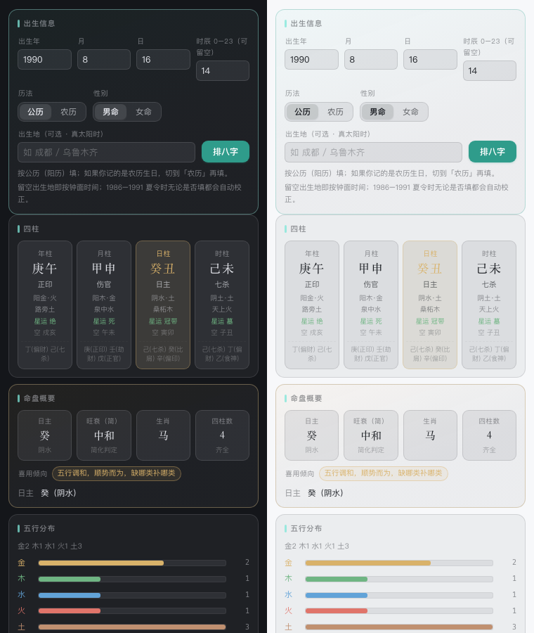
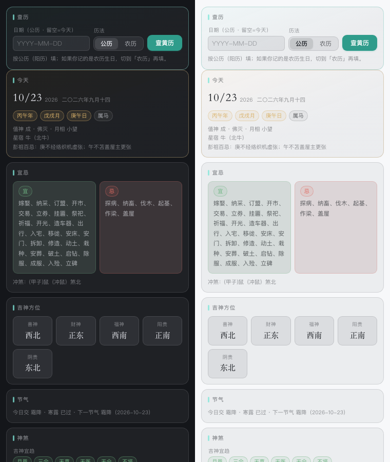
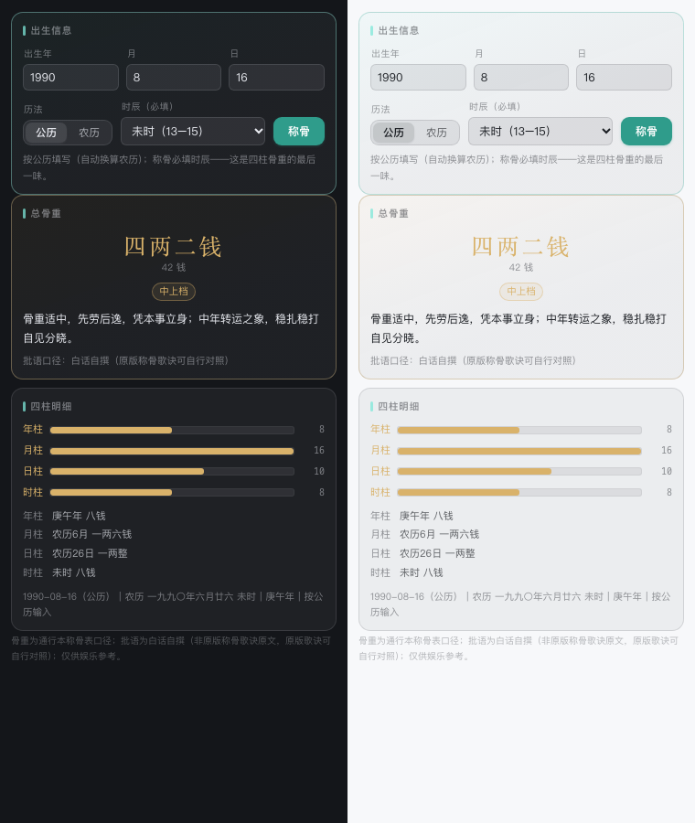
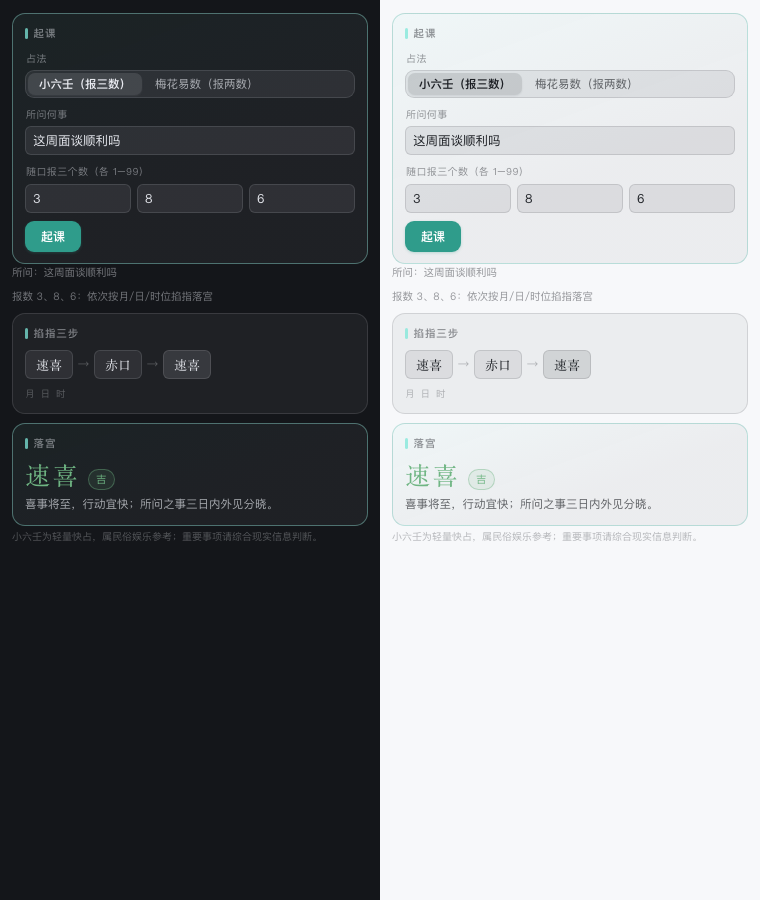
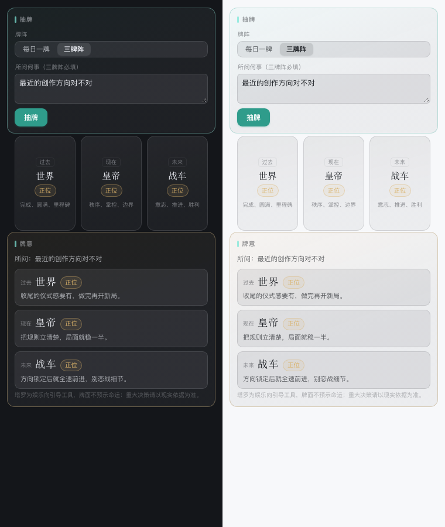

<div align="center">

# dsh-xuanji · 玄机阁

**DeepSeek Harness（DSH）玄学算命插件**

八字 · 紫微斗数 · 梅花易数 · 黄历 · 称骨 · 星座 · 择日 · 风水 · 起名 · 合婚 · 生命数字 · 人生K线 · 塔罗 · 小六壬

*全部由本地确定性引擎计算——干支、星曜、卦象、骨重零模型推演，模型只负责解读。*

[](https://github.com/huangziyuan-general/dsh-xuanji/releases)
[](./LICENSE)
[]()

</div>

---

## 安装

```bash
# 从 npm 安装（推荐——已发版，拉取无需任何凭据）
dsh plugin --profile web add npm:dsh-xuanji

# 从 GitHub 公开仓库（⚠️ github: 简写经 pnpm 走 SSH——机器要配好 GitHub SSH key
# 且 ~/.ssh/known_hosts 里有 github.com 主机指纹，否则更新报 Host key verification failed；
# 没配 SSH 就用上面的 npm 源，公共仓库拉取无需任何凭据）
dsh plugin --profile web add github:huangziyuan-general/dsh-xuanji

# 本地开发（符号链接，改码即生效）
dsh plugin --profile web add link:/path/to/dsh-xuanji
```

要求 Node.js ≥ 20。

## 设计原则

- **模型不推演数值**：一切确定性事实（干支 / 星曜 / 卦象 / 骨重 / 牌面）来自本地引擎的确定性计算，模型不心算、不改盘；
- **四层输出**：排盘事实 → 传统解读 → 现实行动建议 → 免责声明，四层缺一不可（由 systemPrompt 纪律段强制）；
- **缺输入先问不猜**：生辰 / 性别 / 时辰缺失时必须询问用户，绝不允许模型代填猜测值；
- **断语出处标注**：每条断语区分「传统原文 / 传统通行口径 / 简化判定 / 白话自撰 / 自建字库」五级出处，工具未覆盖的如实说明，不臆断补全。

## 工具面（15 个 `xuanji_*` 工具）

| 工具 | 用途 | 关键输入 |
|---|---|---|
| `xuanji_bazi` | 八字排盘：四柱（纳音/藏干/十神/每柱旬空/星运十二长生与自坐）、地支刑冲合会、五行旺衰、胎元命宫身宫、常用神煞 21 种、起运与大运（含起止年份与干支十神）、流年 | 生辰（公历/农历）+ 时辰（可选）+ 性别（+ city/longitude 真太阳时） |
| `xuanji_ziwei` | 紫微斗数：十二宫安星、十四主星亮度与生年四化（禄权科忌）、命主身主五行局；运限层（action=fortune）含大限/流年/小限三环与四化 | 生辰 + 时辰 + 性别 |
| `xuanji_meihua` | 梅花易数：时间起卦 / 报数起卦，本互变卦、动爻、体用生克断吉凶 | mode + 时刻或两个报数 |
| `xuanji_almanac` | 每日黄历：农历干支、宜忌、冲煞、喜神/财神/福神/阳贵/阴贵方位、节气（上一/下一）、节日、值神、星宿、彭祖百忌 + 每日一卦（同日同卦） | 日期（缺省今天） |
| `xuanji_chenggu` | 袁天罡称骨：年月日时骨重求和，分档白话批语 | 生辰 + 时辰 |
| `xuanji_zeri` | 择日：事项 × 黄历宜忌 × 建除十二神 × 冲煞排除，逐日打分排序出推荐日/回避日 | 事项 + 日期区间 + 属相（可选） |
| `xuanji_fengshui` | 风水：八宅命卦（东四/西四命 + 大游年四吉四凶方位，立春界）+ 流年九宫飞星（年家紫白）；action=advise 推宅卦八星盘与门主灶厕布局倾向 + 命宅配（24 山坐向，对宫校验） | 出生年月日 + 性别；advise 需坐山或向山 |
| `xuanji_name` | 起名：评估（八字喜用神对照内置常用字五行字库 241 字逐字打分，未收录如实标注）+ 候选生成（action=generate，按喜用与性别倾向从自建字库组合候选名，确定性排序附字义） | 评估：姓 + 名；生成：姓 + 生辰 + 性别 |
| `xuanji_star` | 星座档案 + 当日四维基调（日期哈希确定性生成，同日同星座同结果） | 日期（缺省今天） |
| `xuanji_trend` | 人生K线：大运×流年十神确定性计分，1–100 岁逐年 OHLC + 大运分段 ASCII 迷你图 + 顺位/谨慎年份 | 生辰 + 性别（时辰可省） |
| `xuanji_tarot` | 塔罗：每日一牌（同日同牌同正逆位）/ 三牌阵（过去现在未来），22 大阿卡纳通行释义 | mode；三牌阵需所问何事 |
| `xuanji_xiaoliuren` | 小六壬马前课：农历月日时或报三数掐指落宫，六宫吉凶断语 | mode（time/number） |
| `xuanji_match` | 八字合婚/合盘：属相关系（六合三合六冲六害相刑）+ 日主生克/天干五合 + 年命纳音 + 简化分档，冲刑害只讲「摩擦点」 | 双方出生年月日（时辰可选） |
| `xuanji_numerology` | 生命数字（西方数字学）：生命路径数/生日数/态度数（11/22/33 主数保留）+ 白话数义，与八字紫微不同口径 | 公历出生年月日 |
| `xuanji_qimen` | 奇门遁甲（时家转盘·拆补法简化口径）：阳遁/阴遁、节气局数、符头、时干支、值符、旬空、八宫地盘九星/天盘九星/八门落宫；时辰必填 | 日期 + 时辰（公历/农历） |

历法与紫微安星由开源确定性计算库承担（见 `package.json` 依赖清单），六十四卦表内置并经完整性与《观梅占》复原双重校验。

## 右侧栏面板（九页）

插件自带右侧栏 client 面板（「玄机阁」tab），六个视图全部只读、零 token。数据来自 `/api/xuanji/*`（与 `xuanji_*` 工具同引擎，只读确定性计算）；缺输入一律 fail-fast 可见，绝不代填。

<div align="center">

| 八字 | 黄历 |
|:---:|:---:|
|  |  |
| **人生K线** | **称骨** |
|  |  |
| **快占** | **塔罗** |
|  |  |

</div>

- **八字**：四柱竖卡（干支/十神/纳音/星运/旬空/藏干）+ 命盘概要 + 五行计数条 + 刑冲合会徽章 + 神煞 chips，出生城市选填（真太阳时）；
- **黄历**：进入自动查今天——农历干支、宜忌两列、冲煞、喜神/财神/福神/阳贵/阴贵方位五格、节气、每日一卦卡；
- **人生K线**：SVG 蜡烛图逐年绘制（收阳红/收阴绿、5/10 年均线、峰谷标注、大运交替色带、悬停看干支分值）；
- **称骨**：生辰 + 十二时辰下拉 → 总骨重盘 + 四柱骨重明细 + 档位批语；
- **快占**：小六壬报三数 / 梅花易数报两数（随口报数 + 所问何事，秒级出落宫/卦象与体用断语）；
- **塔罗**：每日一牌 / 三牌阵（所问何事输入框常驻），CSS 3D 翻牌动画；
- **奇门**：日期 + 时辰下拉 → 阳遁/阴遁局数、值符、旬空 + 九宫格（地_天_门，吉门着色），时家转盘确定性计算；
- **风水**：八宅命卦（东四/西四 + 四吉四凶方位）+ 流年九宫飞星（年家紫白，fyYear 单独可查，标准紫白序列）；
- **合婚**：双方生辰（年月日 + 时辰下拉 + 历法 + 称谓）→ 属相关系 + 双向十神 + 跨盘合会 + 分档（冲刑害只讲「摩擦点」）。

面板深浅主题零探测自适应（`color-mix(currentColor)` 体系），宿主切色无需配置。源码在 `src/client/`，改动后需 `npm run build` 重新产出 `lib/client.js`（dsh 只加载构建产物）。

REST 面带三道防线（本机 Host/Origin 白名单 + fence header），只读、无文件写入。

## 日期输入：公历 / 农历（含闰月）

14 个工具里凡吃日期的入口**一律支持 `calendar=solar|lunar`**（缺省 solar），农历侧再带 `isLeapMonth`：

- 面板（八字 / K线 / 称骨 / 黄历）与工具面同口径：面板上有「公历 / 农历」切换，选农历才出现「闰月」勾选；
- 农历年份以**正月初一**为界，不是公历年——农历 1990 年腊月落在公历 1991 年属正常，结果里会写明；
- 闰月不是每年都有（2023 闰二月、2025 闰六月、2026 无闰月），勾错会被拒并提示该年实际闰月；
- 农历月天数按农历查表（29 或 30）：农历 2023 年二月三十合法，腊月只有 29 天——不会按公历月份天数误拒，也不会静默折算成下月初一；
- 西方体系（星座 / 生命数字 / 塔罗）按公历日期计算，给农历会先换算再算，并在结果里写明换算关系。

## 时间口径（全排盘工具统一）

- **中国夏令时（1986–1991）**：默认自动校正——这六年出生证上的钟面时间普遍快 1 小时，不校正是时柱/时辰错一档的常见事故。
- **真太阳时**：xuanji_bazi / xuanji_ziwei / xuanji_trend / xuanji_name 传 `city`（内置 57 城经度表）或 `longitude` 即按「经度差 + 均时差」校正——例如乌鲁木齐（87.62°E）钟面 14:10 的真太阳时约 11:57（当地太阳正午在北京时间 14:10 左右），成都钟面 15:30 的真太阳时约 14:26、仍在未时。
- **晚子时（23:00–24:00）**：八字日柱归属流派分歧，宿主配置 `ziShi` 可切（1=次日，默认；2=当日）；紫微按次日早子时。
- 所有口径调整都写进返回值的 `meta.notes`，解读时照实转述，不静默改盘。

## 输出示例

```
【八字排盘】1990-08-16 14:30（公历）｜农历 一九九〇年六月廿六｜马年｜男命

四柱：
· 年柱 庚午｜阳金＋火｜纳音_路旁土｜十神_正印｜星运_绝（自坐沐浴）｜旬空_戌亥｜藏干 丁(偏财)、己(七杀)
· 月柱 甲申｜阳木＋金｜纳音_泉中水｜十神_伤官｜星运_死（自坐绝）｜旬空_午未｜藏干 庚(正印)、壬(劫财)、戊(正官)
· 日柱 癸丑｜阴水＋土｜纳音_桑柘木｜十神_日主｜星运_冠带（自坐冠带）｜旬空_寅卯｜藏干 己(七杀)、癸(比肩)、辛(偏印)
· 时柱 己未｜阴土＋土｜纳音_天上火｜十神_七杀｜星运_墓（自坐墓）｜旬空_子丑｜藏干 己(七杀)、丁(偏财)、乙(食神)

刑冲合会（原局地支关系，传统通行口径）：
· 年支午与日支丑六害（凶）
· 年支午与时支未六合（吉）
· 日支丑与时支未六冲（凶）
· 日支丑与时支未相刑
...
```

## 本地开发

```bash
git clone https://github.com/huangziyuan-general/dsh-xuanji.git
cd dsh-xuanji
npm install
npm test          # 先自动 build client，再 node --test，全本地零网络
npm run probe     # 引擎冒烟输出
```

## 边界

排盘是工程，解读是文化。本插件不做医疗、投资、法律断言，恐吓性断语被 systemPrompt 纪律明确禁止；重大现实决策请咨询专业人士。

## License

[MIT](./LICENSE)
