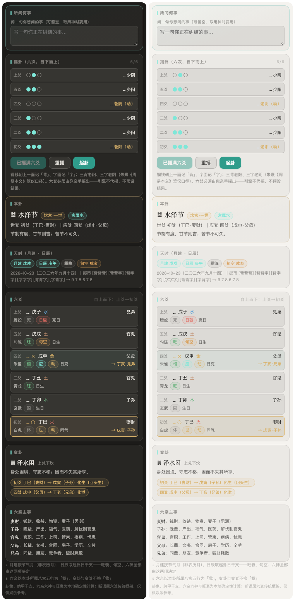

<div align="center">

# dsh-xuanji · Xuanji Ge (Mystic Pavilion)

**A Chinese metaphysics / divination plugin for DeepSeek Harness (DSH)**

BaZi (Four Pillars) · Zi Wei Dou Shu (Purple Star Astrology) · Mei Hua Yi Shu (Plum Blossom I Ching) · Liu Yao (Six Lines / Najia) · Chinese Almanac · Cheng Gu (Bone Weight) · Western Zodiac · Date Selection · Feng Shui · Chinese Naming · Marriage Compatibility · Numerology · Life K-Line · Tarot · Xiao Liu Ren

*Every number is computed on-device by deterministic engines — stem-branches, stars, hexagrams and bone weights are never inferred by the model. The model only interprets.*

[](https://github.com/huangziyuan-general/dsh-xuanji/releases)
[](./LICENSE)
[]()

[English](./README_EN.md) · [简体中文](./README.md)

</div>

---

> **A note on terminology.** Chinese divination terms do not have clean English equivalents, so this document keeps the romanised name plus a short gloss (e.g. *BaZi* = Eight Characters / Four Pillars of Destiny). Nothing here is medical, financial or legal advice — see [Boundaries](#boundaries).

## Install

```bash
# From npm (recommended — published, no credentials needed)
dsh plugin --profile web add npm:dsh-xuanji

# From the public GitHub repo (⚠️ the github: shorthand resolves through pnpm over SSH,
# which needs a working GitHub SSH key and github.com in ~/.ssh/known_hosts, or updates
# fail with "Host key verification failed"; use the npm source above if you have no SSH set up)
dsh plugin --profile web add github:huangziyuan-general/dsh-xuanji

# Local development (symlinked — edits take effect immediately)
dsh plugin --profile web add link:/path/to/dsh-xuanji
```

Requires Node.js ≥ 20.

## Design principles

- **The model never computes.** Every deterministic fact (stems and branches, star positions, hexagrams, bone weights, drawn cards) comes from a local engine. The model does not do mental arithmetic and does not rewrite a chart.
- **Four-layer output.** Chart facts → classical interpretation → practical advice → disclaimer. All four layers are mandatory, enforced by the discipline block injected into the system prompt.
- **Ask, never guess.** Missing birth date, gender or birth hour must trigger a question to the user. The model filling in a guessed value is forbidden.
- **Label every claim's provenance.** Judgements are tagged on a five-level scale: *classical source text / widely accepted traditional convention / simplified rule / plain-language paraphrase /project-built lexicon*. Where the tooling has no coverage, it says so instead of inventing an answer.

## Tool surface (16 `xuanji_*` tools)

| Tool | What it does | Key inputs |
|---|---|---|
| `xuanji_bazi` | BaZi chart: the four pillars (Na Yin / hidden stems / Ten Gods / empty-branch per pillar / 12 Chang Sheng stage and self-seated stage), earthly-branch relations (clash, punishment, combination, union), five-element strength, Tai Yuan / Ming Gong / Shen Gong, 21 common Shen Sha, Qi Yun and the Ten-Year Luck Pillars (with year ranges and Ten Gods), flowing year | Birth datetime (solar/lunar) + hour (optional) + gender (+ `city`/`longitude` for true solar time) |
| `xuanji_ziwei` | Zi Wei Dou Shu: star placement across 12 palaces, brightness of the 14 major stars, birth-year Si Hua (Lu / Quan / Ke / Ji), Ming Zhu & Shen Zhu, element phase; `action=fortune` adds the great-limit / annual / small-limit cycles and their Si Hua | Birth datetime + hour + gender |
| `xuanji_meihua` | Mei Hua Yi Shu: time-based or number-based casting — primary / nuclear / changed hexagram, moving line, Ti–Yong (body–application) generation & restraint verdict | `mode` + timestamp, or two numbers spoken by the user |
| `xuanji_liuyao` | Liu Yao (Six Lines, Jing Fang school): from the user's cast coins → palace attribution, Shi / Ying, Najia stem-branch per line, Liu Qin, Liu Shen, seasonal strength (Wang/Xiang/Xiu/Qiu/Si), Xun Kong (empty branches), month/day break & hidden movement, moving lines and changed hexagram (changed-line stems + returning generation/restraint). **The user must cast — the engine never tosses on their behalf** | Six line numbers (6/7/8/9, bottom-up) or six coin-toss records (back/front) + casting date (defaults today) |
| `xuanji_almanac` | Daily Chinese almanac: lunar stem-branch, Yi/Ji (auspicious & inauspicious activities), clash, directional positions for the five benefic stars, solar terms (previous/next), festivals, Zhi Shen, lunar mansion, Peng Zu taboos + a daily hexagram (same day → same hexagram) | Date (defaults today) |
| `xuanji_chenggu` | Yuan Tian Gang's Cheng Gu ("bone weight"): weight of year/month/day/hour summed, banded plain-language verdict | Birth datetime + hour |
| `xuanji_zeri` | Date selection: activity × almanac Yi/Ji × the 12 Jian Chu officers × clash exclusion, scored per day → recommended / avoid lists | Activity + date range + Chinese zodiac sign (optional) |
| `xuanji_fengshui` | Feng Shui: Eight Mansions life Gua (East/West group + Da You Nian four-auspicious / four-inauspicious directions, Li Chun as year boundary) + annual flying stars (Nine Palaces Zi Bai); `action=advise` derives the house 8-star chart and layout tendency for door/master-stove/bath plus person–house matching (24 mountains, opposite-palace cross-check) | Birth date + gender; `advise` needs sitting or facing mountain |
| `xuanji_name` | Chinese naming: evaluate (scored against the BaZi favourable element using a built-in 241-character common-name lexicon, unreported characters flagged honestly) + generate (`action=generate`, combines candidates from the project lexicon by favourable element and gender tendency, deterministic ordering with meanings) | Evaluate: surname + given name; Generate: surname + birth datetime + gender |
| `xuanji_star` | Western zodiac profile + four-axis daily tone (deterministic date hash — same day and sign give the same result) | Date (defaults today) |
| `xuanji_trend` | Life K-Line: deterministic scoring of luck pillar × annual Ten God → year-by-year OHLC from age 1–100, ASCII mini chart with luck-pillar segments, ranked best / caution years | Birth datetime + gender (hour optional) |
| `xuanji_tarot` | Tarot: daily card (same day → same card and same upright/reversed) / three-card spread (past–present–future), conventional meanings for the 22 Major Arcana | `mode`; three-card spread needs the question |
| `xuanji_xiaoliuren` | Xiao Liu Ren "Ma Qian Ke": month/day/hour or three spoken numbers → position on the hand, six-palace verdict | `mode` (`time`/`number`) |
| `xuanji_match` | BaZi compatibility: zodiac relations (six unions, three unions, six clashes, six harms, punishments) + day-master generation/restraint & heavenly-stem five unions + Na Yin of the year + simplified banding. Clashes are reported as "friction points", never as doom | Both parties' birth dates (hour optional) |
| `xuanji_numerology` | Western numerology: life path / birthday / attitude numbers (master numbers 11/22/33 preserved) + plain-language meanings — a different system from BaZi and Zi Wei, deliberately kept separate | Solar birth date |
| `xuanji_qimen` | Qi Men Dun Jia (hour-plate rotating dial, simplified Chai Bu convention): Yang/Yang-Dun or Yin-Dun, solar-term Ju number, Fu Tou, hour stem-branch, Zhi Fu, Xun Kong, earth-plate / heaven-plate nine stars and eight gates per palace. Hour is required | Date + hour (solar/lunar) |

Calendar arithmetic and Zi Wei star placement are handled by well-established open-source deterministic libraries (see the dependency list in `package.json`); the 64-hexagram table is built in and validated both for completeness and by reconstructing the classic *Guan Mei Zhan* case.

## Side panel (ten pages)

The plugin ships a right-hand client panel (the "Xuanji Ge" tab). All ten views are read-only and cost **zero tokens**. Data comes from `/api/xuanji/*` — the same engines behind the `xuanji_*` tools. Missing input always fails fast and visibly; it is never silently defaulted.

<div align="center">

| BaZi | Almanac |
|:---:|:---:|
|  |  |
| **Life K-Line** | **Cheng Gu** |
|  |  |
| **Quick Cast** | **Tarot** |
|  |  |
| **Liu Yao** | |
|  | |

</div>

- **BaZi** — four vertical pillar cards (stem-branch / Ten God / Na Yin / Chang Sheng / Xun Kong / hidden stems) + chart summary + five-element count bars + clash & combination badges + Shen Sha chips; birth city optional (true solar time).
- **Almanac** — loads today automatically: lunar stem-branch, two-column Yi/Ji, clash, five directional tiles for the benefic stars, solar terms, daily hexagram card.
- **Life K-Line** — year-by-year SVG candlestick chart (up closes red / down closes green in the Chinese convention, 5- and 10-year moving averages, peak/trough labels, colour-banded luck-pillar transitions, hover for stem-branch and score).
- **Cheng Gu** — birth datetime + 12-branch hour dropdown → total weight dial + per-pillar weights + band verdict.
- **Quick Cast** — Xiao Liu Ren with three numbers / Mei Hua with two numbers (speak any numbers and state your question; instant palace or hexagram with a Ti–Yong verdict).
- **Tarot** — daily card / three-card spread (the question box is always visible), CSS 3D flip animation.
- **Qi Men** — date + hour dropdown → Yang/Yin Dun and Ju number, Zhi Fu, Xun Kong + a nine-palace grid (earth / heaven / gate, auspicious gates tinted), fully deterministic hour-plate computation.
- **Feng Shui** — Eight Mansions life Gua (East/West group + four auspicious & four inauspicious directions) + annual Nine Palace flying stars (Zi Bai, `fyYear` queryable on its own, standard sequence).
- **Marriage** — both parties' birth dates (date + hour dropdown + calendar + role) → zodiac relations + bidirectional Ten Gods + cross-chart unions + banding (clashes framed as "friction points").
- **Liu Yao** — toss line by line (the three coins' faces come from your clicks, equivalent to a physical toss; the engine never casts for you or pre-fills) → primary / changed hexagram, palace & Shi–Ying, per-line Najia + Liu Qin + Liu Shen, seasonal strength, Xun Kong and month break, returning generation/restraint on moving lines, and a Liu Qin cheat sheet.

The panel adapts to light and dark hosts with **zero detection** (a `color-mix(currentColor)` system) — no configuration needed when the host switches themes. Source lives in `src/client/`; after editing you must run `npm run build` to regenerate `lib/client.js`, because dsh only loads the built artifact.

The REST surface carries three guards (localhost Host/Origin allowlist + a fence header). It is read-only and writes nothing to disk.

## Date input: solar vs lunar (including leap months)

Every date-taking entry point across the 16 tools **accepts `calendar=solar|lunar`** (defaults to `solar`), with `isLeapMonth` on the lunar side:

- The panel (BaZi / K-Line / Cheng Gu / Almanac) follows the same contract as the tools: there is a solar/lunar toggle, and the leap-month checkbox only appears once lunar is selected.
- Lunar years are bounded by the **first day of the first lunar month**, not by the Gregorian year — it is normal for lunar 1990's twelfth month to fall in Gregorian 1991, and the result says so explicitly.
- Leap months do not occur every year (2023 has leap month 2, 2025 leap month 6, 2026 none). Ticking the wrong one is rejected with the year's actual leap month.
- Lunar month length follows the lunar table (29 or 30 days): lunar 2023 month 2 day 30 is valid, while the twelfth month has only 29 — you are never wrongly rejected by Gregorian month lengths, and nothing is silently folded into the next month's first day.
- The Western systems (zodiac, numerology, tarot) compute on solar dates; a lunar input is converted first and the conversion is stated in the result.

## Time conventions (shared by all chart tools)

- **China Daylight Saving Time (1986–1991)** — corrected automatically by default. Clock times on birth certificates from those six years are commonly one hour fast; skipping the correction is the classic cause of an off-by-one hour pillar.
- **True solar time** — pass `city` (built-in table of 57 cities) or `longitude` to `xuanji_bazi` / `xuanji_ziwei` / `xuanji_trend` / `xuanji_name` to correct by longitude delta plus the equation of time. Example: in Ürümqi (87.62°E) a clock reading of 14:10 corresponds to roughly 11:57 true solar time; in Chengdu 15:30 clock is about 14:26 true solar time and still lands in the Wei hour.
- **Late Zi hour (23:00–24:00)** — schools disagree on which day owns it; the host config `ziShi` switches between next-day (default) and same-day. Zi Wei counts it as the next day's early Zi hour.
- Every convention adjustment is written into `meta.notes` in the return value and must be restated faithfully during interpretation — the chart is never silently altered.

## Example output

```
【BaZi Chart】1990-08-16 14:30 (Gregorian) | Lunar 1990, 6th month, 26th day | Horse year | Male

Four Pillars:
· Year   Geng-Wu   | Yang Metal + Fire | Na Yin_Roadside Earth | Ten God_Direct Resource | Stage_Jue (self-seated Mu Yu) | Xun Kong_Xu Hai | hidden stems Ding (Indirect Wealth), Ji (Seven Killings)
· Month  Jia-Shen  | Yang Wood + Metal | Na Yin_Spring Water   | Ten God_Hurting Officer | Stage_Si   (self-seated Jue)   | Xun Kong_Wu Wei | hidden stems Geng (Direct Resource), Ren (Rob Wealth), Wu (Direct Officer)
· Day    Gui-Chou  | Yin Water + Earth | Na Yin_Mulberry Wood  | Ten God_Day Master      | Stage_Guan Dai (self-seated Guan Dai) | Xun Kong_Yin Mao | hidden stems Ji (Seven Killings), Gui (Parallel), Xin (Indirect Resource)
· Hour   Ji-Wei    | Yin Earth + Earth | Na Yin_Sky Fire       | Ten God_Seven Killings  | Stage_Mu   (self-seated Mu)   | Xun Kong_Zi Chou | hidden stems Ji (Seven Killings), Ding (Indirect Wealth), Yi (Eating God)

Branch relations (natal chart, widely accepted traditional convention):
· Year branch Wu and day branch Chou — Liu Hai (harm), inauspicious
· Year branch Wu and hour branch Wei — Liu He (union), auspicious
· Day branch Chou and hour branch Wei — Liu Chong (clash), inauspicious
· Day branch Chou and hour branch Wei — Xiang Xing (punishment)
...
```

## Local development

```bash
git clone https://github.com/huangziyuan-general/dsh-xuanji.git
cd dsh-xuanji
npm install
npm test          # builds the client first, then runs node --test — fully local, no network
npm run probe     # engine smoke output
```

## Boundaries

Casting a chart is engineering; interpreting it is culture. This plugin makes no medical, investment or legal claims, and fear-based pronouncements are explicitly forbidden by the system-prompt discipline. For major real-world decisions, consult a qualified professional.

## License

[MIT](./LICENSE)
